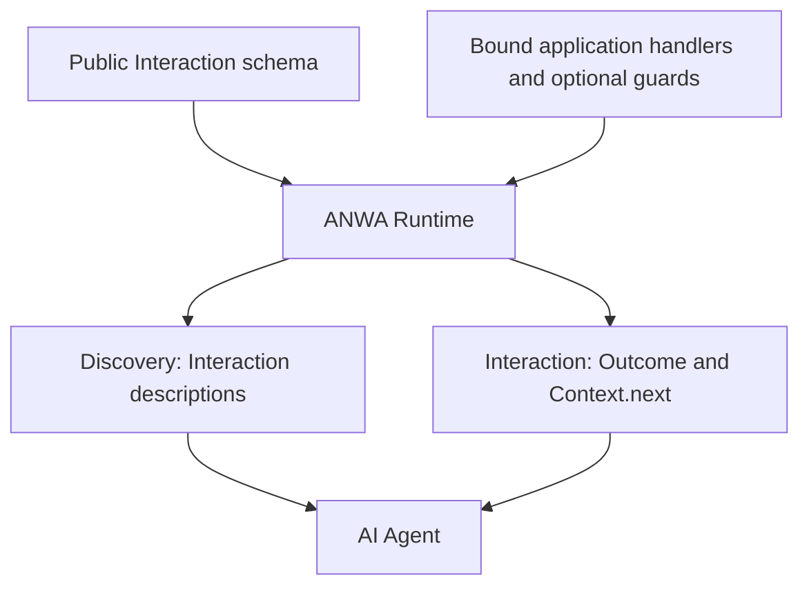

# ANWA

**Agent-Native Web Applications**

> A schema-first framework concept for web applications that AI agents can discover, understand, and interact with — without requiring a predefined human-facing UI.

**Status: Interaction-first experimental v0.2 specification + executable demos on `main`.** In-process TypeScript and Go reference adapters exist; there is no released package, stable API, network protocol, security/conformance guarantee, or published standard.

## Why ANWA?

A human can discover what a web application does by navigating pages and forms. An AI agent should instead be able to **discover application semantics and interactions**, retrieve state, invoke operations, and get enough context to decide where to go next.

ANWA explores an **OpenAPI-like, schema-first development experience**: implementing agents or application authors declare **standalone Interactions** and bind them to ordinary handlers. **Thing is not part of ANWA Core**: an Interaction is independently described, discovered and invoked. The framework exposes what the application chooses to publish; it does not decide domain structure or business workflows.

**Core principle:** *Every delivered application-level interaction result contains an outcome and the context for what can come next.*

The application provides options and constraints; the agent chooses what to do according to the user's intent.

## How it would work



### 1. Define the public contract

Declare top-level **Interactions** (`query`, `action`, `event`), inputs/outputs, expected errors and optional guards. **No `things` or `subjectType` field exists in the active schema**; domain identifiers are ordinary typed input/output values.

**The optional root `$defs` map allows shared payload shapes such as `Task` to be referenced by multiple standalone Interactions with `$ref`; this does **not** introduce Thing or shared resource identity. The schema is not business-logic code.** A guard is declared by name and contract, not reimplemented as a condition language in YAML.

### 2. Implement behavior

Application authors choose domain boundaries, states, policies and follow-up candidates. Each Interaction Handler constructs its **own `Outcome + Context`**, using `reply(result, next)`; there is **no application-wide Context resolver**. A declared named Guard is **evaluated by the Runtime before the Action handler**. On denial, the business `run` method is not called; the Interaction's own `onDenied` callback supplies `context.next`. Application authorization and atomic updates remain application responsibilities.

### 3. Serve a navigable application

Two **logical** interfaces—not necessarily two wire protocols:

| Interface | Responsibility |
| --- | --- |
| **Discovery** | Expose standalone Interaction descriptions and declared types, without a Thing parent or dynamic Context resolver |
| **Interaction** | Read, invoke and observe; return **Outcome + Context**, with a single `context.next` list of next standalone Interactions and optional prebound inputs, guidance/timing |

Interaction may complete immediately with a typed `Result<Success, Error>`, or optionally accept an execution reference that can be observed later (durability depends on the application). **Async execution and streaming observation are different concerns.**

[Architecture and developer workflow](docs/architecture.md) · [Worked order cancellation example](docs/examples/order-cancellation.md) · [Interaction and streaming model](docs/interaction-model.md)

### Authentication and authorization boundary

Authentication is delegated to a trusted Adapter that supplies verified caller information separately from untrusted Interaction input. The in-process runtime enforces declared Guards on **Query, Action and Event**, requires unguarded Interactions to be explicitly marked `public`, and filters Discovery by caller. These are **not** a network authentication implementation or a substitute for atomic application authorization. See [authentication and authorization](docs/authentication-authorization.md).

## Executable v0.2 interaction-first contract lab

The working [v0.2 contract](spec/anwa-0.2.md), [machine-readable schema](spec/anwa-0.2.schema.json), [TypeScript runtime](src/anwa.ts), [Go reference adapter](go/README.md), [schema tooling](src/schema-tools.ts) and [four runnable TypeScript demos](demo/README.md) are on `main`. [v0.1](spec/anwa-0.1.md) is retained as historical research.

```bash
# Bun ^1.4.4
bun install --frozen-lockfile
bun fmt --check src demo test tools
bunx oxlint src demo test tools
bun check
bun test
bun run demo
bun run demo:todo
```

The demos use only first-class InteractionRefs: [Calculator](demo/calculator/), [Orders](demo/orders/) with typed IDs, [async Reports](demo/reports/) with opaque execution IDs, and [Advanced Todo](demo/todo/) with 27 guarded Interactions spanning collaborative workspaces, project/task planning, dependency graphs and audit events. No Thing declarations remain. They demonstrate expressive power, not prescribed app architecture or production runtime features. In particular, the adapter does not provide authentication, durable jobs, network transport, or complete JSON Schema validation.

The [Todo authoring manifest](demo/todo/anwa.json) reuses `Task`, `Project`, and `SavedQuery` schemas through local `$defs` / `$ref`. Codegen expands these into the same literal TypeScript contract as the previously repeated inline definitions; supported references are local, acyclic, and data-only.

**v0.2 is a breaking experimental profile for discussion, not an adopted standard.** See the merged [Minimal Core proposal](docs/proposals/0002-minimal-core.md) for historical design context.

### Go reference adapter

The experimental v0.2 manifest can also be consumed by an in-process [Go module](go/README.md) with no third-party dependencies. It includes JSON contract validation (including local `$defs` / `$ref`), standalone Interaction handlers, Guard-enforced invocation and Discovery, Outcome + Context, accepted Actions and Event observation. The Go calculator example uses the same public `anwa.json` as the TypeScript demo. Go tests read and generate code for all four existing manifests, including Advanced Todo. **Go now generates model types, a compile-time `ServerInterface`, typed response variants, and a runtime binding adapter**; application authors implement the generated interface instead of manually mapping Interaction names to handlers. It is not a network server or a port of Todo business logic.

```bash
cd go
go run ./cmd/anwa-codegen -in ../demo/calculator/anwa.json -out examples/calculator/contract.gen.go -package main
go test ./...
go run ./examples/calculator
```

## Agent-first schema and contract tooling

ANWA's experimental v0.2 Schema-first workflow includes **contract validation**, **schema-derived Handler input/output/error types**, and a **diagnostic schema view**. These tools do not generate business logic. **Human ease of writing the manifest is not a design target**: the contract is primarily for implementing agents and consuming agents.

```bash
bun run validate       # validates demo manifests against the supported schema subset
bun run codegen        # generates typed manifest modules from JSON
bun run types:orders   # generates standalone TypeScript declaration aliases
bun run inspect:orders # renders schema meaning, fields and domain errors as Markdown
bun test               # validates declared errors against runtime behavior
```

For an Action that declares `errors`, **all expected domain error codes must be listed**. An undeclared domain error becomes opaque `UNEXPECTED_ERROR`; `INVALID_INPUT` is framework input validation. **Retries and other follow-up interactions use one `context.next` list**: `guidance.kind: "retry"`, optional `guidance.level`, and optional `when.after`. There is no separate `error.retry`.

**Machine-readable is not the same as AI-effective.** Optional semantic identifiers and Action effect categories are exposed through Discovery, but are untrusted declarations rather than guarantees. We have **not benchmarked agent task performance** against OpenAPI, WoT or MCP. See [Agent-native schema contract](spec/agent-native-schema.md) and [contract validation](docs/schema-authoring.md).

## Vocabulary and relationship to WoT

ANWA uses **W3C Web of Things (WoT)** concepts for comparison, but the v0.2 core is **Interaction-first**, not Thing-bound:

| WoT term | Working use in ANWA |
| --- | --- |
| Thing / Thing Description | WoT prior art for adapters/research; **not present in ANWA Core** |
| Property / Action / Event Affordance | Prior-art Thing-bound concepts; ANWA uses top-level `query` / `action` / `event` |
| Link | WoT relation concept; ANWA's current continuation contract is `context.next` |
| DataSchema / Form | Typed data and a protocol-specific interaction binding |

**WoT Interaction Affordance describes an offered interaction; it does not mean an action is currently authorized or guaranteed to succeed.** ANWA is investigating separate **contextual applicability** hints, plus a common Result + Context response. These are proposed ANWA abstractions, **not WoT TD 1.1 fields**.

ANWA is **WoT-informed, not currently WoT-compliant**. GraphQL, REST, RPC, MCP and related technologies remain possible adapters rather than required foundations.

[WoT-aligned Glossary](docs/glossary.md) · [Framework vs application boundaries](docs/scope-and-boundaries.md) · [Current decisions and non-decisions](docs/decisions.md)

## Documentation map

| Start here | Document |
| --- | --- |
| Vision & scope | [Vision](docs/vision.md) |
| Responsibility boundary and feature-evaluation method | [Scope & boundaries](docs/scope-and-boundaries.md) |
| Working decisions / unresolved choices | [Decision status](docs/decisions.md) |
| Schema-first architecture | [Architecture](docs/architecture.md) |
| Step-by-step schema + code example | [Order cancellation](docs/examples/order-cancellation.md) |
| Result, async execution, streaming | [Interaction model](docs/interaction-model.md) |
| Errors, retry guidance and next-interaction navigation (`context.next`) | [Error recovery and navigation](docs/error-recovery-navigation.md) |
| Established and proposed terminology | [Glossary](docs/glossary.md) |
| Risks, next tests, unresolved design | [Open questions](docs/open-questions.md) |
| Comparison against existing work | [Prior art](docs/prior-art.md) |
| Executable Interaction-first profile | [ANWA 0.2 contract](spec/anwa-0.2.md) |
| Schema reference | [Manifest / Result JSON Schema](spec/anwa-0.2.schema.json) |
| Agent-first semantic design contract | [Agent-native schema](spec/agent-native-schema.md) |
| Generation and validation | [Schema authoring and tooling](docs/schema-authoring.md) |
| Working demos and tests | [Demo guide](demo/README.md) |
| Go implementation guide and example | [Go reference adapter](go/README.md) |
| Proposed concrete shape (not adopted) | [Proposal 0001 — Draft PR](https://github.com/pomesaka/ANWA/pull/1) |

### Research notes

- [Hydra / Hypermedia](docs/research/hydra.md)
- [W3C WoT, WoT Discovery and node-wot](docs/research/wot.md)
- [WoT error handling](docs/research/wot-errors.md)
- [Async, state machines and streaming](docs/research/async-state-streaming.md)

## Prior art & primary references

ANWA is **not claiming that machine-readable operations or navigable responses are new inventions**. These ideas already exist across Hypermedia, WoT and agent protocols.

| Standard / project | Relevance | Official source |
| --- | --- | --- |
| REST / Web Linking | Navigable representations and typed link relations | [RFC 8288](https://www.rfc-editor.org/info/rfc8288) |
| Hydra | Hypermedia links, operations and generic clients | [Hydra Core Vocabulary](https://docs.hydra-cg.com/spec/latest/core/) |
| W3C WoT | Thing Description, Interaction Affordances, Forms and protocol bindings | [TD 1.1](https://www.w3.org/TR/wot-thing-description11/) |
| W3C WoT Discovery | Introduction, Exploration and Thing Description directories | [Discovery](https://www.w3.org/TR/wot-discovery/) |
| OpenAPI | Machine-readable API contract and schema-first tooling | [OpenAPI Specification](https://spec.openapis.org/oas/latest.html) |
| GraphQL | Typed schema, introspection, data selection and mutations | [GraphQL Specification](https://spec.graphql.org/September2025/) |
| SCXML | State machines and transitions | [W3C Recommendation](https://www.w3.org/TR/scxml/) |
| MCP | Agent-facing tools and resources | [MCP Specification](https://modelcontextprotocol.io/specification/2025-11-25) |
| A2A | Task states, updates and output streaming | [A2A Specification](https://a2a-protocol.org/latest/specification/) |
| CloudEvents | Common event envelope | [CloudEvents Specification](https://github.com/cloudevents/spec) |

These are **references, not mandatory dependencies or endorsements**. Hydra's community specification is unfinished; WoT TD 1.1 is a W3C Recommendation, while WoT Profiles remains a Working Draft. See [Prior Art](docs/prior-art.md).

## Status and contributing

The repository now includes **working documents and a runnable experimental in-process prototype**. Its v0.2 Interaction-first JSON profile is a testable proposal, not a final schema or public API. Network transports, runtime security, full JSON Schema compliance, versioning and licensing remain unselected. External API delegation/federated references are future work, not a v0.2 guarantee. The immediate goal is to test whether the framework lets developers express agent-navigable applications with less duplication and acceptable interoperability costs. **Application design choices remain with application authors**; example orders/payments are tests of expressive power, not universal ANWA requirements.

Corrections, competing prior art and design feedback are welcome via issues or PRs. Please distinguish **established standard behavior** from **ANWA proposals**.

**License:** Not yet selected. No open-source license is granted merely by making a repository public.

---

<details>
<summary>日本語概要</summary>

ANWA（Agent-Native Web Applications）は、**AIエージェントが直接探索・理解・操作できるWebアプリケーション**を作るための、Schema-firstなフレームワーク構想です。

実装エージェントは公開スキーマにInteractionを定義し、生成した型を使うTypeScript Handlerで各操作の結果と`context.next`を返します。ANWA CoreにThingはありません。宣言したGuardはRuntimeがActionより先に評価します。業務ルール・永続化・次に提示する操作はアプリケーション実装者が決めます。

WoTの語彙を優先しますが、ANWA独自のResult形式や状態依存の案内はまだ設計仮説です。現在のv0.2ではInteractionをThingなしで公開・発見・実行します。Runtime・デモ・テストはBun ^1.4.4 / TypeScriptです。実験実装と動作デモはありますが、製品向けの安全性や互換性は保証していません。

</details>
