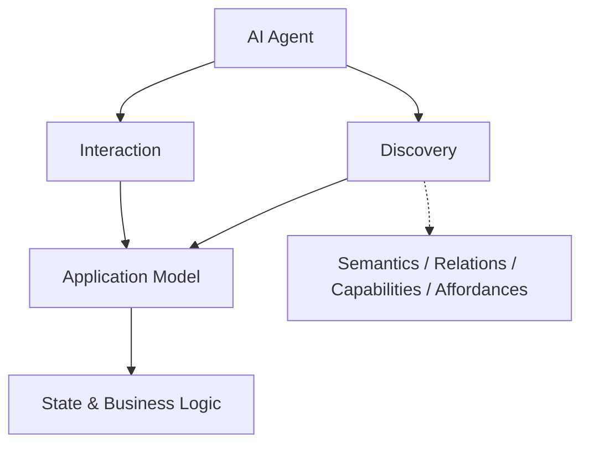

# ANWA

**Agent-Native Web Applications**

> A framework concept for building web applications that AI agents can discover, understand, and interact with.

**Status: Early exploration** · No implementation or stable API yet.

ANWA explores a different starting point for web application development: **what if the primary client is an AI agent, rather than a human-facing UI?**

Instead of requiring a client to understand a predefined page structure, an ANWA-style application would expose its domain semantics, relationships, capabilities, and contextual affordances in a machine-discoverable form. Agents could then retrieve data, invoke operations, and—when useful—compose a human-facing view.

This repository is currently a **design and research workspace**, not a published standard or production-ready library.

## The idea

A traditional web application often communicates what is possible through pages, navigation, and forms. ANWA investigates how an application can communicate similar information directly to software agents.

The proposed model separates two *logical* concerns:

| Interface | Purpose | Questions it answers |
| --- | --- | --- |
| **Discovery** | Explore meaning, relations, capabilities, and affordances | What is this? What is related? What could I do next? |
| **Interaction** | Retrieve state, invoke business operations, and observe results | What is its current state? Can I perform this action? What happened? |

These are **not necessarily two network protocols or a mandatory two-step sequence**. An agent might follow `discover → read → discover → invoke → observe` while working toward a goal.

### Working vocabulary (WoT-aligned)

ANWA currently uses **W3C WoT terminology as its starting point**, rather than redefining established concepts:

- **Thing / Thing Description** — an entity (physical or virtual) and its machine-readable interaction description.
- **Interaction Affordance** — a described interaction, specialized as **Property**, **Action**, or **Event Affordance**.
- **Link** — a typed connection to a related resource.
- **Form / Protocol Binding** — how a specific interaction is actually performed.

**Contextual availability** (whether a particular caller can act on an entity *now*) is an **ANWA research concern**, not the official meaning of WoT Affordance. Describing an interaction does not guarantee authorization or successful execution.

See the [WoT-aligned glossary](docs/glossary.md) and [WoT error-handling research](docs/research/wot-errors.md).

### Example scenario

An agent is asked to cancel an order it has never seen before.

1. Discover the order's meaning and related shipment information.
2. Discover the cancellation capability, its inputs, conditions, and potential side effects.
3. Read the specific state required to make a decision.
4. Request any required human approval, then attempt the operation.
5. Inspect the result or observe the resulting state.

The agent would not need the application's bespoke UI. A human-facing view could still be generated or provided when needed.

## Design directions (hypotheses, not decisions)

- **Protocol-independent application model.** GraphQL, RPC, REST, MCP, or other interfaces may be adapters rather than the core abstraction.
- **Progressive discovery.** An agent should be able to explore relevant parts of an application without receiving the entire schema up front.
- **Self-description.** A resource or operation should carry sufficient structured information and explanation to help clients interpret it.
- **Context-sensitive affordances.** A capability's general existence is distinct from whether it appears available for a specific object and user.
- **Separation of hints and enforcement.** Discovery metadata never replaces authorization, validation, or other server-side safeguards.
- **Optional presentation.** Human-facing UI is supported, but not the fundamental unit of the application.

No wire format, framework API, programming language, datastore, or adapter has been selected.

## Prior art & references

ANWA builds on decades of work in hypermedia, typed APIs, and machine-readable interaction descriptions. The objective is **not to rebrand existing ideas as novel**, but to test whether an agent-oriented application framework can make them easier to combine and use.

| Project / standard | Relevant ideas | Official source |
| --- | --- | --- |
| **Hypermedia / Web Linking** | Typed links and discoverable relationships between resources | [RFC 8288 — Web Linking](https://www.rfc-editor.org/info/rfc8288) |
| **Hydra** | Hypermedia-driven APIs, supported operations, machine-readable API documentation | [Hydra Core Vocabulary](https://www.hydra-cg.com/spec/latest/core/) |
| **W3C Web of Things (WoT)** | Interaction Affordances, properties/actions/events, data schemas, protocol bindings | [Thing Description 1.1](https://www.w3.org/TR/wot-thing-description11/) |
| **GraphQL** | Typed application graph, schema descriptions, introspection, queries and mutations | [GraphQL Specification](https://spec.graphql.org/September2025/) |
| **Model Context Protocol (MCP)** | Exposing tools and resources to AI applications through an interoperable protocol | [MCP Specification](https://modelcontextprotocol.io/specification/2025-11-25) |
| **Agent2Agent (A2A)** | Agent discovery, agent capabilities, delegation, and task lifecycle | [A2A Specification](https://a2a-protocol.org/latest/specification/) |

The links above point to primary specifications. They represent **related work**, not ANWA dependencies or endorsements. In particular, W3C WoT and Hydra already address much of the affordance/discovery space. ANWA must establish its value through comparison, not vocabulary alone.

See [Prior Art](docs/prior-art.md) for the distinctions and research questions associated with each. Detailed primary-source research: [Hydra](docs/research/hydra.md) and [W3C WoT](docs/research/wot.md) (including its Discovery specification, 2026–2028 roadmap, and Eclipse node-wot).

Additional research: [Async execution, state machines & streaming](docs/research/async-state-streaming.md).

## Documentation

| Document | Contents |
| --- | --- |
| [Vision](docs/vision.md) | Problem framing, scope, proposed direction |
| [Glossary](docs/glossary.md) | Working definitions and important distinctions |
| [Prior Art](docs/prior-art.md) | Primary sources and overlaps with existing standards |
| [Open Questions](docs/open-questions.md) | What is not decided and how to evaluate the idea |

## Project status & contributing

This repository currently contains **concept notes only**. There is no package to install, protocol to implement, or compatibility promise. Feedback, corrections to terminology, and references to relevant prior art are welcome through GitHub issues or pull requests.

Before proposing an API shape, please consult the [open questions](docs/open-questions.md). In particular, distinguish an experimentally useful framework abstraction from a feature already provided by an existing specification.

**License:** Not yet selected. Until a license is added, do not assume rights to redistribute or reuse the repository's contents outside applicable law.

---

日本語での概要

ANWA（Agent-Native Web Applications）は、**AIエージェントが直接探索・理解・操作できるWebアプリケーション**のためのフレームワーク構想です。画面やGraphQL/MCPなどの特定の技術を中心に据えるのではなく、アプリケーションの意味（Semantics）、関係（Relations）、能力（Capabilities）、状態に応じた操作の手がかり（Affordances）を、段階的に発見できる抽象化を検討しています。

現段階では設計前の思考実験・一次資料調査を記録しており、APIやプロトコルは確定していません。

