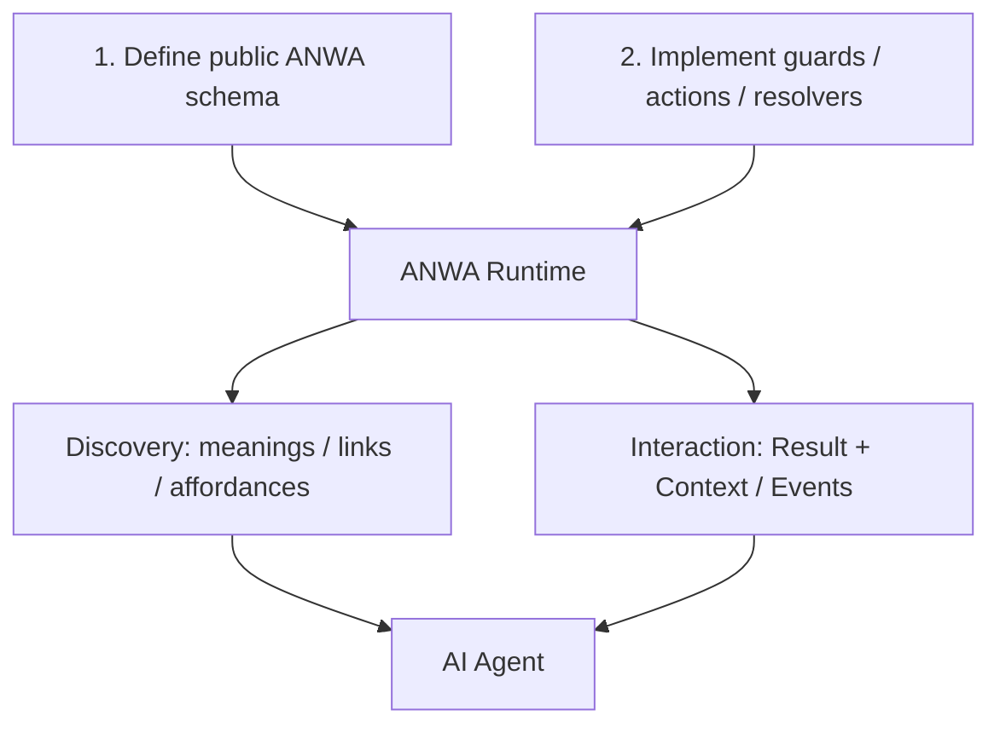

# ANWA

**Agent-Native Web Applications**

> A schema-first framework concept for web applications that AI agents can discover, understand, and interact with — without requiring a predefined human-facing UI.

**Status: Early design / research.** No package, stable schema, runtime, compatibility guarantee, or published standard exists yet.

## Why ANWA?

A human can discover what a web application does by navigating pages and forms. An AI agent should instead be able to **discover application semantics and interactions**, retrieve state, invoke operations, and get enough context to decide where to go next.

ANWA explores an **OpenAPI-like, schema-first development experience**: define the public contract, implement business logic in normal code, and let the framework expose both discovery and interaction interfaces.

**Core principle:** *Every delivered application-level interaction result contains an outcome and the context for what can come next.*

The application provides options and constraints; the agent chooses what to do according to the user's intent.

## How it would work

### 1. Define the public contract

Describe **Things**, Properties, Actions, Events, Links, input/output types, possible states/transitions, documented errors, and named Guard references.

**The schema is not business-logic code.** A guard is declared by name and contract, not reimplemented as a condition language in YAML.

### 2. Implement behavior

Developers implement handlers, relation resolvers, state updates, and guards in regular code. The **same guard implementation** may power Discovery-time applicability hints and Invocation-time checks. Real authorization and transactional enforcement still happen on the server.

### 3. Serve a navigable application

Two **logical** interfaces—not necessarily two wire protocols:

| Interface | Responsibility |
| --- | --- |
| **Discovery** | Find Thing descriptions, semantics, related Links and Property/Action/Event Interaction Affordances, optionally with state/caller-specific applicability hints |
| **Interaction** | Read, invoke and observe; return **Outcome + Context** (links and next-interaction references), on domain success or failure |

Interaction may complete immediately with a typed `Result<Success, Error>`, or accept a durable execution to observe later. **Async execution and streaming observation are different concerns.**

[Architecture and developer workflow](docs/architecture.md) · [Worked order cancellation example](docs/examples/order-cancellation.md) · [Interaction and streaming model](docs/interaction-model.md)

## Vocabulary and relationship to WoT

ANWA currently adopts the **W3C Web of Things (WoT)** vocabulary as a starting point:

| WoT term | Working use in ANWA |
| --- | --- |
| Thing / Thing Model / Thing Description | A domain-facing object, reusable description and published interaction metadata |
| Property / Action / Event Affordance | Describes how data is read, an operation invoked, or notifications observed |
| Link | Related resource/Thing |
| DataSchema / Form | Typed data and a protocol-specific interaction binding |

**WoT Interaction Affordance describes an offered interaction; it does not mean an action is currently authorized or guaranteed to succeed.** ANWA is investigating separate **contextual applicability** hints, plus a common Result + Context response. These are proposed ANWA abstractions, **not WoT TD 1.1 fields**.

ANWA is **WoT-aligned, not currently WoT-compliant**. GraphQL, REST, RPC, MCP and related technologies remain possible adapters rather than required foundations.

[WoT-aligned Glossary](docs/glossary.md) · [Current decisions and non-decisions](docs/decisions.md)

## Documentation map

| Start here | Document |
| --- | --- |
| Vision & scope | [Vision](docs/vision.md) |
| Working decisions / unresolved choices | [Decision status](docs/decisions.md) |
| Schema-first architecture | [Architecture](docs/architecture.md) |
| Step-by-step schema + code example | [Order cancellation](docs/examples/order-cancellation.md) |
| Result, async execution, streaming | [Interaction model](docs/interaction-model.md) |
| Established and proposed terminology | [Glossary](docs/glossary.md) |
| Risks, next tests, unresolved design | [Open questions](docs/open-questions.md) |
| Comparison against existing work | [Prior art](docs/prior-art.md) |
| Proposed concrete shape (not adopted) | [Proposal 0001 — Draft PR](https://github.com/pomesaka/ANWA/pull/1) |

### Research notes

- [Hydra / Hypermedia](docs/research/hydra.md)
- [W3C WoT, WoT Discovery and node-wot](docs/research/wot.md)
- [WoT error handling](docs/research/wot-errors.md)
- [Async, state machines and streaming](docs/research/async-state-streaming.md)

## Prior art & primary references

ANWA is **not claiming that machine-readable operations or navigable responses are new inventions**. These ideas already exist across Hypermedia, WoT and agent protocols.

| Standard / project | Relevance | Official source |
| --- | --- | --- |
| REST / Web Linking | Navigable representations and typed link relations | [RFC 8288](https://www.rfc-editor.org/info/rfc8288) |
| Hydra | Hypermedia links, operations and generic clients | [Hydra Core Vocabulary](https://docs.hydra-cg.com/spec/latest/core/) |
| W3C WoT | Thing Description, Interaction Affordances, Forms and protocol bindings | [TD 1.1](https://www.w3.org/TR/wot-thing-description11/) |
| W3C WoT Discovery | Introduction, Exploration and Thing Description directories | [Discovery](https://www.w3.org/TR/wot-discovery/) |
| OpenAPI | Machine-readable API contract and schema-first tooling | [OpenAPI Specification](https://spec.openapis.org/oas/latest.html) |
| GraphQL | Typed schema, introspection, data selection and mutations | [GraphQL Specification](https://spec.graphql.org/September2025/) |
| SCXML | State machines and transitions | [W3C Recommendation](https://www.w3.org/TR/scxml/) |
| MCP | Agent-facing tools and resources | [MCP Specification](https://modelcontextprotocol.io/specification/2025-11-25) |
| A2A | Task states, updates and output streaming | [A2A Specification](https://a2a-protocol.org/latest/specification/) |
| CloudEvents | Common event envelope | [CloudEvents Specification](https://github.com/cloudevents/spec) |

These are **references, not mandatory dependencies or endorsements**. Hydra's community specification is unfinished; WoT TD 1.1 is a W3C Recommendation, while WoT Profiles remains a Working Draft. See [Prior Art](docs/prior-art.md).

## Status and contributing

The repository currently hosts **working documents only**. Schema syntax, runtime, protocol bindings, versioning and licensing are not selected. The immediate goal is to test whether schema-first authoring plus contextual Interaction Results lets agents navigate unfamiliar applications more reliably, without excessive annotation or tool-call costs.

Corrections, competing prior art and design feedback are welcome via issues or PRs. Please distinguish **established standard behavior** from **ANWA proposals**.

**License:** Not yet selected. No open-source license is granted merely by making a repository public.

---

日本語概要

ANWA（Agent-Native Web Applications）は、**AIエージェントが直接探索・理解・操作できるWebアプリケーション**を作るための、Schema-firstなフレームワーク構想です。

開発者はOpenAPIのような公開スキーマでThing、Action、状態遷移、関連リソース、Guardの契約を宣言し、GuardやActionのビジネスロジックは通常のコードで実装します。ANWAがDiscoveryとInteractionを公開し、成功・失敗どちらの結果にも関連するリソースと次に検討できる操作の情報を付けることを目指します。

WoTの語彙を優先しますが、ANWA独自のResult形式や状態依存の案内はまだ設計仮説です。実装も仕様も未確定です。

