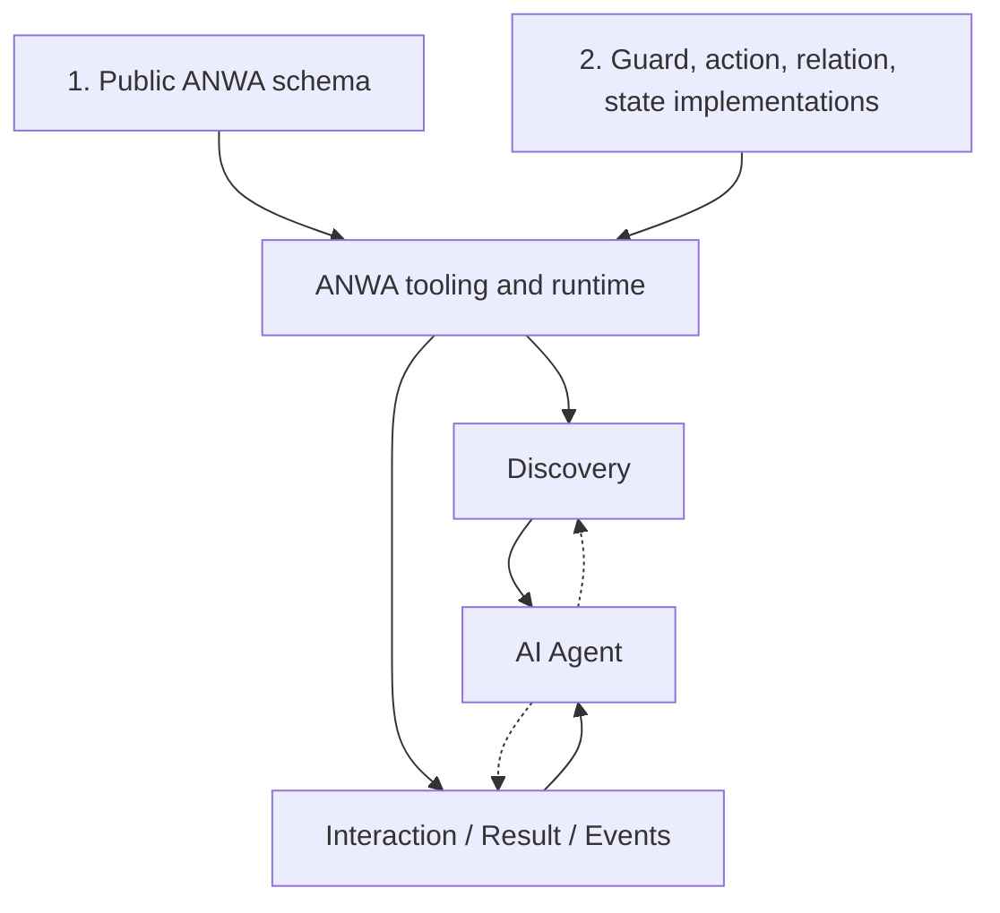

# ANWA architecture — current working model

> **Status:** Working direction, **not a published specification** · 2026-11-01  
> Read alongside [decisions.md](decisions.md). The examples below are explanatory, not valid ANWA syntax.

## Core thesis

**ANWA is a schema-first application framework for AI agents.**

A developer describes the **public contract** of an application in a machine-readable schema, then implements the behavior in ordinary application code. The ANWA runtime uses that contract and the implementation to expose:

1. **Discovery** — understand Things, their meanings, Links, Property/Action/Event Interaction Affordances, input/output types, and relevant choices.
2. **Interaction** — read state, invoke actions, and observe results. A delivered application response contains **Outcome + Context** (related resources and next-interaction hints), whether the domain action succeeded or failed.

Discovery and Interaction are *logical concerns*, not necessarily different network endpoints or transports. Agents may alternate between them. GraphQL, RPC, REST and MCP are candidate bindings/adapters; none is required by this conceptual model.

## Authoring workflow



### Step 1 — Declare the contract

OpenAPI-style schema authoring: define **Thing models**, properties, actions, events, links, descriptions, input/output schemas, error categories, and *possible* states/transitions where useful. An action may **reference a named guard**. The schema does **not** express arbitrary business rules as a new guard programming language.

### Step 2 — Implement behavior

Write real code for:
- Property readers and Link resolvers
- Named guard evaluations, returning structured allow/deny results
- Action handlers and side effects
- Durable state changes and transitions
- Execution lifecycle, subscriptions and output producers if required

A guard can query databases, remote services, permissions and current domain state. Its **returned reason and related hints** can help ANWA explain a blocked action, but the returned data must be filtered and should not expose sensitive information.

### Step 3 — Bind, validate, expose

The framework can validate declared names/types against implementations, expose authorized descriptions, evaluate dynamic applicability, invoke handlers, and assemble an Interaction Response with follow-up hints.

This is a **goal**, not yet a proven automated capability. Code-level type checking does not establish that a side effect actually obeys a declared transition. A runtime must check invariants and the storage layer must protect atomicity/consistency.

## Responsibility split

| Concern | Schema (public contract) | Implementation / enforcement | Potential framework-generated surface |
| --- | --- | --- | --- |
| Thing / Property / Action / Event | Meaning, types, descriptions | Resolver and side effects | Discovery schema and callable interaction |
| Links | Relation type and target model | Relation resolver + access policy | Related Thing references |
| State / Transition | Named states and possible transitions | Read state, validate and persist transitions | State-aware action hints and transition checks |
| Guard | Name, result/error categories, human-readable meaning | Actual predicate and structured decision | Contextual applicability / blocked reason |
| Errors | Stable codes and documented meaning | When the error is returned and whether effects occurred | Typed `Result` error |
| Async | Declared capability/behavior (extent TBD) | Execution state and persistence | Execution reference, snapshot/observation adapters |
| Streaming | Documented events / outputs | Delivery and backpressure | Subscription and event representation |
| Authorization | Discoverable security requirements when safe | Mandatory server-side enforcement | Scope-filtered discovery; never a permission grant |

## State model: contract, not a second implementation

Consider `Order.cancel`:

- Schema says `cancel` is an Action, may cause `pending/preparing → cancelled`, and refers to `canCancelOrder`.
- Code implements `canCancelOrder` **once** and implements the cancellation with a transactional/conditional update.
- Discovery can evaluate the guard to give a **hint** about applicability.
- Invocation **re-evaluates** policy and state and then executes atomically where required.

No independent `availableWhen: status=pending` formula is kept in the schema if the real guard is more complicated. Some state transition metadata remains declarative (documentation/validation), but **guard conditions are authored as code**, not duplicated in a YAML DSL.

**Caveat:** using the same guard function twice does not eliminate a time-of-check/time-of-use race. Conditional updates, locks or transactions are still required.

## Outcome and contextual navigation

`InteractionResponse` is a proposed **ANWA logical envelope**, not a WoT or HTTP standard:

```ts
type InteractionResponse<T, E> = {
  outcome:
    | { kind: "settled"; result: Result<T, E> }
    | { kind: "accepted"; execution: ExecutionRef };
  context: {
    subject: ThingRef;
    links: LinkRef[];
    affordances: AffordanceRef[]; // WoT-style affordance references + contextual hints
    revision?: string;
  };
};
```

- `settled`: this invocation finished with a typed success or domain error.
- `accepted`: server accepted an execution that may finish later, **not business success**.
- Links and affordances may be empty. They are **options for the agent**, not instructions to follow.
- WoT **Interaction Affordance** is an interaction description; ANWA **contextual applicability** (e.g. blocked because already shipped) is a separate, non-WoT concept.
- Semantically meaningful error details (reason, retry guidance, side-effect uncertainty) are preferred to relying on HTTP status alone. The underlying transport still follows its own protocol requirements.

See [Interaction and observation](interaction-model.md).

## Non-blocking and streaming

Separate **domain state** (Order: pending/paid/...) from **execution state** (accepted/running/settled/...). Streaming is an **observation method**, not necessarily the state store.

A client may query a snapshot, watch state changes, receive artifact chunks, and later retrieve the authoritative settled Result. Disconnection can leave outcome/side effects unknown; never assume safe retries based solely on a connection error.

Current proposal: full Context on application-level initial/settled results; intermediate stream messages may carry **deltas and references** instead of repeating all possible actions. The exact subscription, replay, ordering and durability contract is open.

## Protocol and vocabulary alignment

W3C WoT terms are preferred as a **vocabulary baseline**: Thing, Thing Description, Thing Model, Property/Action/Event Interaction Affordances, Link, Form, DataSchema. This does **not** mean ANWA currently emits conforming WoT Thing Descriptions.

A schema-first framework can generate protocol bindings later; it must not assume WoT, GraphQL, MCP or OpenAPI can express an ANWA context envelope without adapters or extensions.

## Primary references

- [W3C WoT Thing Description 1.1](https://www.w3.org/TR/wot-thing-description11/)
- [W3C WoT Discovery](https://www.w3.org/TR/wot-discovery/)
- [W3C SCXML](https://www.w3.org/TR/scxml/)
- [WoT Profiles — Working Draft](https://www.w3.org/TR/wot-profile/)
- [GraphQL Specification](https://spec.graphql.org/September2025/)
- [OpenAPI Specification](https://spec.openapis.org/oas/latest.html)

[README](../README.md) · [Decisions](decisions.md) · [Example](examples/order-cancellation.md) · [Open questions](open-questions.md)
